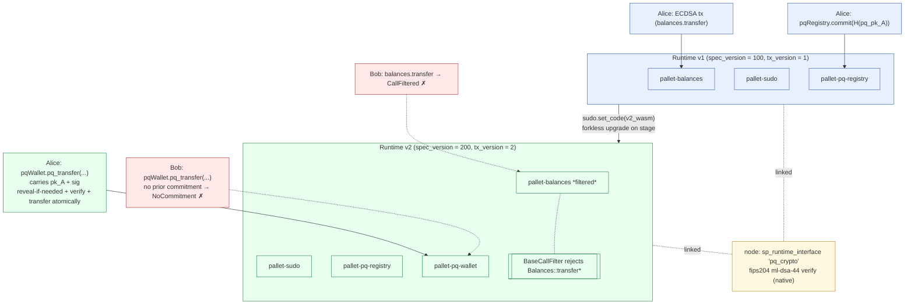

# QuantumLeap — Design Spec

**Date:** 2026-05-23
**Status:** Approved for implementation
**Owner:** Jay Popat

A crypto-agile Substrate chain with hash-committed post-quantum recovery. A working demonstration that a live, running blockchain can swap out its core signature scheme — from ECDSA to ML-DSA — via a forkless runtime upgrade, while protecting users who pre-committed against both classical and post-quantum harvest-now-decrypt-later (HNDL) attacks.

This document is the single source of truth for the hackathon build. It supersedes the original brainstorm spec in conversation history; deltas vs. that draft are noted inline.

---

## 1. TL;DR

- **What:** A solochain Substrate node that boots on ECDSA, then mid-pitch upgrades its runtime to ML-DSA (FIPS-204) signature verification via `sudo.set_code`. Same chain, same accounts, no halt.
- **Novelty:** Users hash-commit their future PQC pubkey *under the still-trusted classical key*. The PQC pubkey itself stays secret until first spend (lazy reveal). This defends against HNDL on the PQC layer — a threat the ecosystem has barely started discussing.
- **Why it wins:** Substrate's forkless runtime upgrades *are* crypto-agility, by design. Nothing else in the room will demo it this cleanly.
- **Stack:** `polkadot-sdk-solochain-template` + `fips204` v0.4 (native, exposed via `sp_runtime_interface`) + two custom pallets + existing React/PAPI frontend with two new screens.

---

## 2. Threat model

### Adversary capabilities (Q-day v1)
- Can break ECDSA in polynomial time (Shor's on a CRQC, or a classical cryptanalytic break).
- Has historical chain data (can replay any past-broadcast signature/pubkey).
- Can submit transactions to the chain at network speed.
- Cannot break SHA-3/Blake2 preimage resistance (Grover's gives only sqrt speedup → 128-bit security on 256-bit hash).
- Cannot break ML-DSA (today's assumption).

### Adversary capabilities (Q-day v2, future)
- ML-DSA gets broken later. We need a path to swap to the next NIST scheme without forking the chain or losing user assets.

### Out of scope
- Network-level attacks (eclipse, DoS).
- Side-channel attacks on signer hardware.
- Pre-upgrade attacker who breaks ECDSA *and* races the chain governance — this is a governance-speed problem, not solvable by crypto alone. Flagged honestly in the pitch.

---

## 3. Architecture



### Invariants
1. **Same chain.** No fork, no halt, no asset migration. State (balances, registry) carries through the upgrade.
2. **Same AccountIds.** Account IDs are still derived classically pre-upgrade; post-upgrade, the registry maps existing AccountIds → PQ pubkey hashes. No identity migration.
3. **Lazy reveal.** A PQ pubkey is never on-chain until the account spends for the first time post-upgrade. Cold storage stays HNDL-safe indefinitely.

### Why a host function, not in-WASM
The PQ verifier runs as a Substrate `sp_runtime_interface` — native code in the node binary, called from the WASM runtime. Trade-offs:

- **Pro:** No `wasm32-unknown-unknown` no_std compile gamble. `fips204` runs with full std on the host.
- **Pro:** Faster verify (~ms range, well under block budget).
- **Pro:** Matches how Polkadot ships BLS12-381 and other expensive crypto today.
- **Con:** Node operators must run the updated binary before the runtime upgrade. The runtime alone can't ship new host fns to old nodes.
- **Honesty in pitch:** "node operators upgrade once, then crypto-agility is forklessly available from that point forward."

---

## 4. Component specs

### 4.1 `primitives/pq-crypto` — host function

A `#[runtime_interface]` trait exposing ML-DSA-44 verify to the runtime. Single point of swap when ML-DSA is succeeded.

```rust
// primitives/pq-crypto/src/lib.rs
#![cfg_attr(not(feature = "std"), no_std)]

pub const PQ_PK_LEN: usize = 1312;     // ML-DSA-44 public key
pub const PQ_SIG_LEN: usize = 2420;    // ML-DSA-44 signature

#[sp_runtime_interface::runtime_interface]
pub trait PqCrypto {
    /// Verify an ML-DSA-44 signature. Empty context per FIPS-204 §3.6.1 default.
    /// Returns false on any decoding or verification failure (no panics).
    fn verify(pubkey: &[u8], sig: &[u8], msg: &[u8]) -> bool {
        use fips204::ml_dsa_44;
        use fips204::traits::{SerDes, Verifier};

        let Ok(pk_arr): Result<[u8; PQ_PK_LEN], _> = pubkey.try_into() else { return false; };
        let Ok(sig_arr): Result<[u8; PQ_SIG_LEN], _> = sig.try_into() else { return false; };
        let Ok(vk) = ml_dsa_44::PublicKey::try_from_bytes(pk_arr) else { return false; };
        vk.verify(msg, &sig_arr, &[])  // fips204 v0.4: returns bool directly
    }
}

pub const COMMIT_DOMAIN: &[u8] = b"QL_PQ_COMMIT_V1";

pub fn commitment_hash(pq_pubkey: &[u8]) -> sp_core::H256 {
    let mut input = sp_std::vec::Vec::with_capacity(COMMIT_DOMAIN.len() + pq_pubkey.len());
    input.extend_from_slice(COMMIT_DOMAIN);
    input.extend_from_slice(pq_pubkey);
    sp_io::hashing::blake2_256(&input).into()
}
```

`Cargo.toml` deps: `fips204 = { version = "0.4", features = ["ml-dsa-44"] }` (host-side only, std). Runtime-side calls cross the host boundary at zero PQC dep cost.

Node registration: the host fn is added to the `ExtensionsFactory` in `node/src/service.rs`. Pattern mirrors how the polkadot-sdk solochain template registers built-in host fns; we follow the BLS12-381 example in `sp-io`.

### 4.2 `pallet-pq-registry` — exists in v1 and v2

Single-purpose: lets accounts commit a hash of a future PQC pubkey, signed by their currently-trusted (classical) key. Includes `recommit` for pre-upgrade key rotation.

**Storage**
```rust
#[pallet::storage]
pub type Commitment<T: Config> = StorageMap<
    _, Blake2_128Concat,
    T::AccountId, H256,
    OptionQuery,
>;
```

**Extrinsics**
```rust
#[pallet::call]
impl<T: Config> Pallet<T> {
    /// Commit H("QL_PQ_COMMIT_V1" || pq_pubkey). Origin is the account's
    /// classical signature (standard signed extrinsic flow).
    /// One-shot: cannot overwrite an existing commitment. Use `recommit` to rotate.
    #[pallet::call_index(0)]
    #[pallet::weight(T::WeightInfo::commit())]
    pub fn commit(origin: OriginFor<T>, hash: H256) -> DispatchResult {
        let who = ensure_signed(origin)?;
        ensure!(!Commitment::<T>::contains_key(&who), Error::<T>::AlreadyCommitted);
        Commitment::<T>::insert(&who, hash);
        Self::deposit_event(Event::Committed { who, hash });
        Ok(())
    }

    /// Rotate the commitment. V1 path only: signed by classical key.
    /// Useful pre-Q-day for "I might have generated PQ keys on a compromised laptop".
    /// V2 (PQ-signed) recommit is future work.
    #[pallet::call_index(1)]
    #[pallet::weight(T::WeightInfo::recommit())]
    pub fn recommit(origin: OriginFor<T>, new_hash: H256) -> DispatchResult {
        let who = ensure_signed(origin)?;
        ensure!(Commitment::<T>::contains_key(&who), Error::<T>::NotCommitted);
        Commitment::<T>::insert(&who, new_hash);
        Self::deposit_event(Event::Recommitted { who, new_hash });
        Ok(())
    }
}
```

**Events:** `Committed { who, hash }`, `Recommitted { who, new_hash }`
**Errors:** `AlreadyCommitted`, `NotCommitted`

### 4.3 `pallet-pq-wallet` — v2 only

The PQC spending path. Unsigned extrinsic with `ValidateUnsigned` gating so it enters the tx pool without classical sigs (which are now untrusted). Reveal is **lazy**: bundled into the first spend.

**Storage**
```rust
#[pallet::storage]
pub type Revealed<T: Config> = StorageMap<
    _, Blake2_128Concat,
    T::AccountId, BoundedVec<u8, ConstU32<1312>>,
    OptionQuery,
>;

#[pallet::storage]
pub type Nonce<T: Config> = StorageMap<
    _, Blake2_128Concat,
    T::AccountId, u64,
    ValueQuery,
>;
```

**Single extrinsic — atomic reveal-if-needed + verify + transfer**
```rust
#[pallet::call]
impl<T: Config> Pallet<T> {
    #[pallet::call_index(0)]
    #[pallet::weight(T::WeightInfo::pq_transfer())]
    pub fn pq_transfer(
        origin: OriginFor<T>,
        from: T::AccountId,
        to: T::AccountId,
        amount: BalanceOf<T>,
        nonce: u64,
        pq_pubkey: BoundedVec<u8, ConstU32<1312>>,
        sig: BoundedVec<u8, ConstU32<2420>>,
    ) -> DispatchResult {
        ensure_none(origin)?;  // unsigned; validated via ValidateUnsigned

        // 1. Reveal or consistency check.
        if let Some(stored) = Revealed::<T>::get(&from) {
            ensure!(stored.as_slice() == pq_pubkey.as_slice(), Error::<T>::PubkeyMismatch);
        } else {
            let commitment = pallet_pq_registry::Commitment::<T>::get(&from)
                .ok_or(Error::<T>::NoCommitment)?;
            ensure!(
                commitment == pq_crypto::commitment_hash(&pq_pubkey),
                Error::<T>::CommitmentMismatch,
            );
            Revealed::<T>::insert(&from, pq_pubkey.clone());
            Self::deposit_event(Event::Revealed { who: from.clone() });
        }

        // 2. Nonce.
        let expected = Nonce::<T>::get(&from);
        ensure!(nonce == expected, Error::<T>::BadNonce);

        // 3. Signature (verified again here even though validate_unsigned already did —
        //    standard Substrate hygiene; the host fn is ~ms so cost is negligible).
        let msg = encode_transfer_msg::<T>(&from, &to, amount, nonce);
        ensure!(
            pq_crypto::verify(&pq_pubkey, &sig, &msg),
            Error::<T>::BadSignature,
        );

        Nonce::<T>::insert(&from, nonce + 1);
        T::Currency::transfer(&from, &to, amount, ExistenceRequirement::AllowDeath)?;
        Self::deposit_event(Event::PqTransfer { from, to, amount });
        Ok(())
    }
}
```

**`ValidateUnsigned`** — gates the tx pool against PQ-sig spam:
```rust
#[pallet::validate_unsigned]
impl<T: Config> ValidateUnsigned for Pallet<T> {
    type Call = Call<T>;
    fn validate_unsigned(_source: TransactionSource, call: &Self::Call) -> TransactionValidity {
        let Call::pq_transfer { from, to, amount, nonce, pq_pubkey, sig } = call
            else { return InvalidTransaction::Call.into(); };

        // Either the stored pubkey must match, or the commitment hash must.
        if let Some(stored) = Revealed::<T>::get(from) {
            if stored.as_slice() != pq_pubkey.as_slice() {
                return InvalidTransaction::Custom(1).into();
            }
        } else {
            let Some(commitment) = pallet_pq_registry::Commitment::<T>::get(from)
                else { return InvalidTransaction::Custom(2).into(); };
            if commitment != pq_crypto::commitment_hash(pq_pubkey) {
                return InvalidTransaction::Custom(3).into();
            }
        }

        let msg = encode_transfer_msg::<T>(from, to, *amount, *nonce);
        if !pq_crypto::verify(pq_pubkey, sig, &msg) {
            return InvalidTransaction::BadProof.into();
        }

        ValidTransaction::with_tag_prefix("PqTransfer")
            .priority(100)
            .and_provides((from.clone(), *nonce))
            .longevity(64)
            .propagate(true)
            .build()
    }
}
```

**Canonical signing payload:**
```rust
pub const TRANSFER_DOMAIN: &[u8] = b"QL_PQ_TRANSFER_V1";

fn encode_transfer_msg<T: Config>(
    from: &T::AccountId,
    to: &T::AccountId,
    amount: BalanceOf<T>,
    nonce: u64,
) -> Vec<u8> {
    let chain_id: u32 = T::ChainId::get();
    let spec_version: u32 = <T as frame_system::Config>::Version::get().spec_version;
    (TRANSFER_DOMAIN, chain_id, spec_version, from, to, amount, nonce).encode()
}
```

`T::ChainId: Get<u32>` is added to `pallet_pq_wallet::Config`; the runtime supplies it via `parameter_types! { pub const ChainId: u32 = 42; }`. Hardcoded for the demo; cheap to make a runtime constant later.

`spec_version` inside the signed payload means a future v3 upgrade automatically invalidates any v2 signatures an attacker may have harvested.

### 4.4 Runtime composition

**`runtime/v1`** — boot state:
```rust
construct_runtime!(
    pub enum Runtime {
        System: frame_system,
        Timestamp: pallet_timestamp,
        Aura: pallet_aura,
        Grandpa: pallet_grandpa,
        Balances: pallet_balances,
        Sudo: pallet_sudo,
        PqRegistry: pallet_pq_registry,
        TransactionPayment: pallet_transaction_payment,
    }
);

pub const VERSION: RuntimeVersion = RuntimeVersion {
    spec_name: create_runtime_str!("quantumleap"),
    impl_name: create_runtime_str!("quantumleap"),
    authoring_version: 1,
    spec_version: 100,
    impl_version: 1,
    transaction_version: 1,
    state_version: 1,
    apis: RUNTIME_API_VERSIONS,
};
```

**`runtime/v2`** — adds PqWallet, filters classical transfers, bumps both versions:
```rust
pub struct PqBaseCallFilter;
impl Contains<RuntimeCall> for PqBaseCallFilter {
    fn contains(call: &RuntimeCall) -> bool {
        !matches!(call,
            RuntimeCall::Balances(pallet_balances::Call::transfer_allow_death { .. })
            | RuntimeCall::Balances(pallet_balances::Call::transfer_keep_alive { .. })
            | RuntimeCall::Balances(pallet_balances::Call::transfer_all { .. })
        )
    }
}

// frame_system::Config:
//   type BaseCallFilter = PqBaseCallFilter;

construct_runtime!(
    pub enum Runtime {
        System: frame_system,
        Timestamp: pallet_timestamp,
        Aura: pallet_aura,
        Grandpa: pallet_grandpa,
        Balances: pallet_balances,
        Sudo: pallet_sudo,
        PqRegistry: pallet_pq_registry,
        PqWallet: pallet_pq_wallet,           // ← new
        TransactionPayment: pallet_transaction_payment,
    }
);

pub const VERSION: RuntimeVersion = RuntimeVersion {
    // ...
    spec_version: 200,                         // ← bumped
    transaction_version: 2,                    // ← bumped: removing accepted calls is a tx-semantic change
    // ...
};
```

Storage migration is trivial (new maps default to None/0 for existing accounts); no `OnRuntimeUpgrade` hook needed.

### 4.5 `tools/sign-cli` — client-side signing (off-chain)

PAPI has no ML-DSA support, so the frontend cannot sign PQ transfers directly. A small standalone Rust CLI generates keys and produces signed payloads as JSON for the frontend to submit verbatim.

```toml
[package]
name = "sign-cli"
version = "0.1.0"
edition = "2021"

[dependencies]
fips204 = { version = "0.4", features = ["ml-dsa-44", "default-rng"] }
parity-scale-codec = { version = "3", features = ["derive"] }
serde = { version = "1", features = ["derive"] }
serde_json = "1"
hex = "0.4"
clap = { version = "4", features = ["derive"] }
```

Subcommands the demo needs:
- `sign-cli keygen --out alice.json` → `{ pk_hex, sk_hex }`
- `sign-cli commit-hash --pk alice.json` → emits the H256 to hand to `pqRegistry.commit`
- `sign-cli sign-transfer --sk alice.json --from <id> --to <id> --amount N --nonce N --chain-id N --spec-version 200 --out tx.json` → emits `{ pubkey_hex, sig_hex, from, to, amount, nonce }`

The frontend reads `tx.json` (or accepts pasted hex) and submits `pqWallet.pq_transfer(...)`. Zero crypto in JS.

### 4.6 Frontend

Existing `frontend/` (Vite + React 19 + PAPI + Talisman + Tailwind/daisyUI) gets two new pages:

- **`/commit`** — input a hex H256, signs `pqRegistry.commit(hash)` via Talisman classical key. Polls until on-chain.
- **`/pq-send`** — accepts a `tx.json` upload or pasted hex bundle, submits `pqWallet.pq_transfer(...)`. Polls block explorer for inclusion + `PqTransfer` event.

Pre-stage: file-upload + a "load presigned demo tx" button that ships with the build.

---

## 5. Cryptographic design

### 5.1 Commitment
`H = blake2b_256("QL_PQ_COMMIT_V1" || pq_pubkey)`
- Domain separation prevents cross-protocol commitment reuse.
- Blake2b is native to Substrate; 128-bit quantum security via Grover's.

### 5.2 Signing payload
SCALE-encoded `(TRANSFER_DOMAIN, chain_id, spec_version, from, to, amount, nonce)`.
- `TRANSFER_DOMAIN`: prevents reuse as a different call (e.g. a future `pq_burn`).
- `chain_id`: prevents cross-chain replay.
- `spec_version`: **the agility lock-in** — a future v3 verifier rejects v2 signatures automatically.
- `nonce`: standard per-account replay protection.

### 5.3 Why ML-DSA-44
- Smallest of the three NIST-standardised params: PK 1312 B, sig 2420 B.
- NIST security Cat-2 (≥ AES-128 classical, also classical post-quantum).
- Fastest verify.
- Trade-off honestly named: ~3.7 KB per transfer (pubkey + sig) vs. ~70 B ECDSA.

### 5.4 Why hash-commit + lazy reveal
Three threats it addresses:
1. **HNDL on ML-DSA pubkeys.** No PQ pubkey enters the network until first spend. Cold-storage funds stay HNDL-safe indefinitely.
2. **Post-upgrade ECDSA forgery.** An attacker who breaks ECDSA after the upgrade can't forge transfers — `BaseCallFilter` rejects them at the pool, and `pq_transfer` requires a PQ sig.
3. **Trust handoff.** Classical key authorises the commit while still trusted. PQ key authorises everything after.

Honest limits:
- Pre-upgrade ECDSA break + governance delay = window where an attacker can write a commitment for any uncommitted account. Defence is governance speed.
- After first reveal, the PQ pubkey is public; rotate by recommit + a fresh PQ keypair before any anticipated break.

---

## 6. Security analysis

### Threat table

| # | Threat | Defence | Residual risk |
|---|---|---|---|
| 1 | ECDSA broken post-upgrade | v2 `BaseCallFilter` rejects classical transfers at pool admission | None for committed users |
| 2 | ECDSA broken pre-upgrade | Governance speed; pre-emptive commit; v1 `recommit` for compromised PQ-keygen environments | Window between break and upgrade; non-committers fully exposed |
| 3 | ML-DSA broken in future | Same pattern repeats: new commitment under current PQ key, then runtime upgrade to next scheme | Same window problem at scheme N+1 |
| 4 | HNDL on PQ pubkey | Hash-commit + **lazy reveal**; pubkey only ever on-chain after first spend | Once revealed, pubkey is public — rotate before any anticipated break |
| 5 | Replay of v2 sig on v3 | `spec_version` in signing payload | None |
| 6 | Cross-account / cross-call replay | Domain separator + `from` in signed payload | None |
| 7 | Tx pool spam with bad PQ sigs | `ValidateUnsigned` verifies sig before pool admission | CPU cost of one host-fn call per unsigned tx |
| 8 | Host-fn divergence (malicious node) | Single well-known `fips204` crate, deterministic output; node binary is reproducible | Same risk profile as BLS12-381 host fns on Polkadot today |

### Decentralisation trade-offs
- **Consensus-critical native verifier.** All nodes run identical `fips204` builds. Deterministic (pure Rust, no FP, no platform intrinsics).
- **Larger storage / bandwidth.** ~3.7 KB per transfer vs. ~70 B ECDSA. Acceptable for non-HFT chains; the production split (reveal-once + transfer-many) amortises the pubkey overhead.
- **Verifier latency.** ML-DSA-44 verify is ~ms. At 6 s block time, plenty of headroom.

### Deployment considerations
- Production version uses on-chain governance (referenda + timelock) for `set_code`, not sudo.
- Customers need a UX flow to commit early. Fidelity ships this as a one-click "Enable PQ recovery" toggle.
- Existing chains can adopt this as a sidecar pallet without forking — the registry only needs read access to balances.
- Hybrid mode (require BOTH ECDSA AND ML-DSA in pre-upgrade phase) is a natural next step; skipped for the hackathon to keep the demo crisp.

---

## 7. Demo flow (3 minutes, on stage)

**Pre-stage:**
- Local dev chain on v1 running, two pre-funded accounts (Alice, Bob).
- v2 WASM blob on disk, hash known.
- Backup video recorded of the whole flow (Saturday night + Sunday morning takes).
- Frontend running; sign-cli outputs for Alice's commit + her first PQ transfer pre-generated.

**0:00 – 0:30  Hook**
> "Imagine a Tuesday in 2030. Someone announces a working quantum break of ECDSA. Every wallet on every major chain is drained inside an hour — every wallet *except* the ones that did one thing five years earlier. Let me show you that one thing."

**0:30 – 1:00  v1 chain, classical world**
- Block production at 6 s; Alice → Bob transfers 10 units via standard `balances.transfer`.

**1:00 – 1:30  The commit**
- Alice generates ML-DSA-44 keypair locally via `sign-cli keygen`.
- Frontend `/commit` page → Talisman signs `pqRegistry.commit(H(pk_A))`.
- On-chain `Committed` event shown; pubkey itself never leaves Alice's laptop.

**1:30 – 2:00  Q-day**
- Sudo calls `system.setCode(v2_wasm_hex)`.
- Block produced, `spec_version` ticks 100 → 200, `transaction_version` ticks 1 → 2 live on screen.
- No halt, no re-sync, same accounts.

**2:00 – 2:30  Post-upgrade**
- Bob clicks classical "transfer" → `CallFiltered` error toast. Red X on the button.
- Alice clicks "PQ send" → frontend loads `tx.json`, submits `pqWallet.pq_transfer(...)`. Single event `PqTransfer { from: Alice, to: Bob, amount: 10 }` — reveal + transfer in one atomic step. Balances update.
- Bob tries the same path → `NoCommitment` error. **The customer is responsible for pre-committing. That's the product.**

**2:30 – 3:00  Reach**
- "The commit step is one extrinsic. It wraps a Fidelity wallet button today. Customers who tap it once survive Q-day. Customers who don't, don't."
- "The chain's crypto is now upgradable forever. When ML-DSA falls, the same pattern swaps to whatever NIST blesses next. Crypto-agility as a runtime upgrade."

**Q&A 1 min** — see §10.

---

## 8. Implementation plan

### Saturday 2026-05-23

| Time | Block | Output |
|---|---|---|
| 09:00–09:30 | Replace parachain template with `polkadot-sdk-solochain-template` | Repo skeleton on new base |
| 09:30–11:00 | `primitives/pq-crypto` host fn + node registration; std `fips204` test | Verifier callable from runtime |
| 11:00–11:30 | `set_code` upgrade smoke test on unmodified solochain | Upgrade flow proven |
| 11:30–13:00 | `pallet-pq-registry` (commit + v1 recommit) + unit tests | Pallet 1 done |
| 13:00–14:00 | Lunch | — |
| 14:00–16:30 | `pallet-pq-wallet` (`pq_transfer` lazy reveal + `ValidateUnsigned`) + unit tests | Pallet 2 done |
| 16:30–17:00 | Mentor check-in | External sanity check |
| 17:00–19:00 | `runtime/v2` (`PqBaseCallFilter`, spec_version 200, tx_version 2); build v2 WASM | Two runtimes on disk |
| 19:00–20:00 | Dinner | — |
| 20:00–22:00 | End-to-end local upgrade flow with `sign-cli` + `polkadot-js-apps`; **record backup video v1** | Critical insurance |

### Sunday 2026-05-24

| Time | Block | Output |
|---|---|---|
| 09:00–11:00 | Add `/commit` + `/pq-send` pages to existing React frontend (PAPI) | Stage-ready interface |
| 11:00–11:30 | Mentor check-in | — |
| 11:30–12:30 | Architecture diagram, slides, pitch script v1 | Pitch artifacts draft |
| 12:30–13:00 | Re-record demo cleanly; **backup video v2** | Final insurance |
| 13:00–14:00 | Lunch + pitch rehearsal ×3 | — |
| 14:00 | **SUBMIT** (repo, video, slides, architecture diagram) | — |
| 14:30 | Present (3 min + 1 min Q&A) | — |

---

## 9. Repo structure

```
quantumleap/
├── README.md                     # one-command demo, links to video
├── docs/
│   └── superpowers/specs/
│       └── 2026-05-23-quantumleap-design.md  # this document
├── Cargo.toml                    # workspace
├── primitives/
│   └── pq-crypto/                # sp_runtime_interface host fn + commitment_hash helper
├── pallets/
│   ├── pq-registry/
│   └── pq-wallet/
├── runtime/
│   ├── v1/                       # spec_version = 100, tx_version = 1
│   └── v2/                       # spec_version = 200, tx_version = 2, PqBaseCallFilter
├── node/                         # solochain template + host fn registration
├── tools/
│   └── sign-cli/                 # std Rust binary: keygen, commit-hash, sign-transfer → JSON
├── frontend/                     # existing React/PAPI; + /commit + /pq-send pages
└── scripts/
    ├── build-v2-wasm.sh
    └── record-demo.sh            # ffmpeg piped from node logs + screen
```

---

## 10. Risk register

| Risk | Likelihood | Impact | Mitigation |
|---|---|---|---|
| Host-fn registration in `node/service.rs` finicky | Low | Medium | Copy the BLS12-381 pattern from `sp-io` source; allow ~1h debug budget. |
| Substrate compile loops eat the day | Medium | High | Use `cargo check` aggressively; batch builds; two-terminal workflow (one builds, one edits). |
| Live `set_code` fails on stage | Medium | High | Pre-recorded backup video, two takes. |
| Demo script has a bug under pressure | Medium | Medium | End-to-end run ×5 Sunday morning. Idempotent state-reset script. |
| Solo burnout | High | High | Hard stop 22:00 Saturday. Sleep is the cheapest performance gain. |
| Pitch runs over 3 minutes | Medium | Medium | Rehearse with stopwatch ×3 minimum. Cut content, not delivery. |

---

## 11. Anticipated Q&A

- **"What about accounts that didn't commit?"** — Honest answer: exposed. Same as not enabling 2FA. Pre-committing is the product.
- **"What about chains that aren't Substrate?"** — Pattern generalises; we built on Substrate because forkless runtime upgrades are first-class. EVM equivalent is ERC-4337 + verifier swap; less elegant.
- **"Why ML-DSA-44 not -87?"** — Smaller sigs, faster verify; -44 is NIST Cat-2 (≥ AES-128 equivalent). Trivial to swap.
- **"What if `fips204` has a bug?"** — Verifier is a swappable runtime interface. Same upgrade mechanism we used for the scheme change applies to the implementation.
- **"3.7 KB per transfer is huge."** — For the hackathon we ship the simpler single-extrinsic shape. Production splits reveal-once + transfer-many to amortise the pubkey cost across thousands of subsequent transfers.
- **"Why host fn, not in-WASM?"** — Faster verify, no wasm32 no_std compile gamble, matches how Polkadot ships BLS12-381 today. Trade-off: node operators upgrade once to gain the new host fn before the runtime upgrade can use it.
- **"What's commercialisable?"** — The commit endpoint as a wallet feature. Zero customer friction, zero chain changes. Ships as an SDK + one-tap UI element.

---

## 12. Open questions / future work

- **On-chain governance, not sudo.** Production version uses referenda + timelock + cancellation lever. Out of scope for 48h.
- **V2 (PQ-signed) recommit.** Second-cycle agility: when ML-DSA falls, the same commit/reveal pattern bootstraps the next scheme using the current PQ key as the trust anchor. Mentioned in deck; not built.
- **Hybrid signing mode.** Pre-upgrade, require *both* ECDSA and ML-DSA for high-value accounts. Smooth migration path.
- **Bridge to existing chains.** Pattern can wrap any chain that supports remote sigverify via a parachain. Pitchable as "we don't need a new chain — we can extend yours."
- **Stateless commitments via Merkle accumulators.** For chains with millions of accounts, per-account storage of commitments is expensive. A Merkle tree of commitments with light-client inclusion proofs scales better.
- **Multi-sig commitments.** Commit `H(pk1 || pk2 || ... || threshold)`; reveal n-of-m for transfer. Useful for custody.
- **ZK-of-verify for cross-chain.** Prove ML-DSA verification in a ZK-friendly system; settle on Ethereum cheaply. Big scope.

---

## 13. Pitch deck outline (8 slides max)

1. **Title** — QuantumLeap: crypto-agility as a runtime upgrade.
2. **The threat** — ECDSA, HNDL, the Q-day timeline. One chart.
3. **The gap** — existing approaches (wallet hybrids, sidechains) publish PQ pubkeys today, leaking them for future cryptanalysis. The 3.7 KB / tx trade-off named explicitly.
4. **Our approach** — hash-commit + lazy reveal + forkless runtime upgrade. One sentence each.
5. **Architecture diagram** — §3 rendered.
6. **Demo** — embed the video; live attempt if time + nerves allow.
7. **Security & trade-offs** — three honest bullets: pre-upgrade window, sig size, node operator co-ordination on host fn.
8. **What ships Monday** — commit endpoint integrated in a wallet → customers gain Q-day survival with one tap. Generalises to any Substrate chain. The agility primitive carries forward to scheme N+1.
